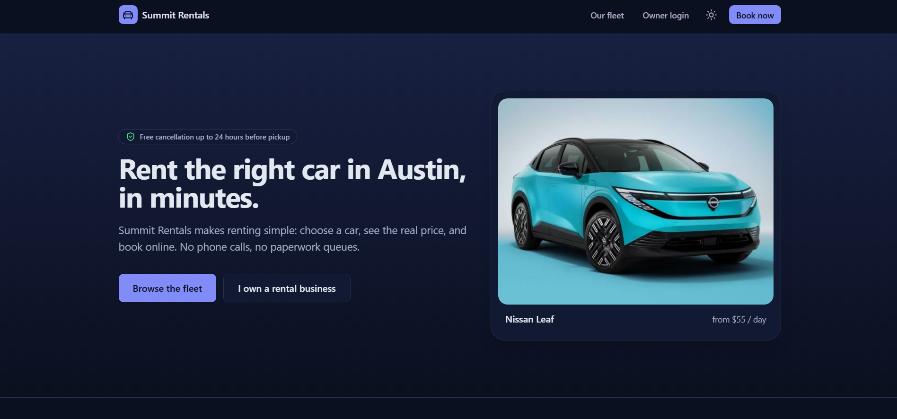
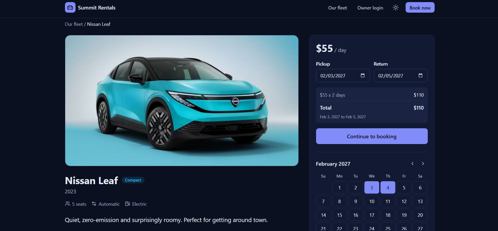
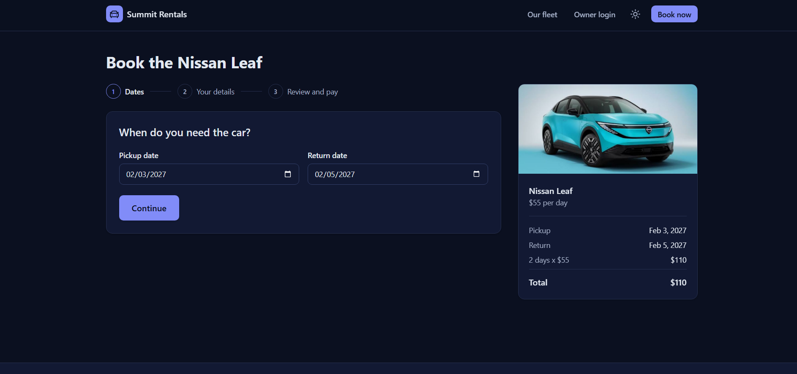
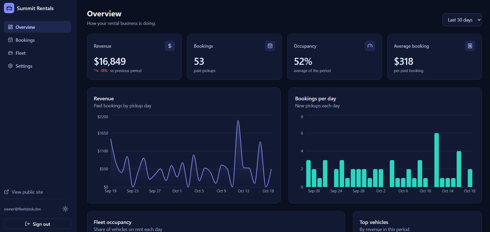
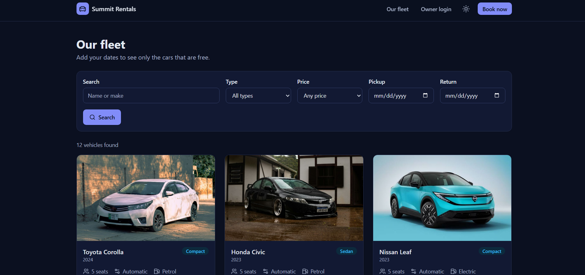

# FleetDesk

A booking and operations app for a small car rental business. Customers pick a car, see which days are free, and book and pay online. The owner manages bookings, the fleet and revenue from a dashboard.

**Live demo:** https://fleetdesk-booking-platform.vercel.app

|             |                                                                                       |
| ----------- | ------------------------------------------------------------------------------------- |
| Owner login | `owner@fleetdesk.dev` / `demo1234` (the login page has a "Fill in demo login" button) |
| Test card   | `4242 4242 4242 4242`, any future date, any CVC (`4000 0000 0000 0002` is declined)   |

## Screenshots

| Home                                    | Car page                                                              |
| --------------------------------------- | --------------------------------------------------------------------- |
|  |  |

| Booking flow                                         | Owner dashboard                                      |
| ---------------------------------------------------- | ---------------------------------------------------- |
|  |  |

| Fleet List Views Customer and Owner                      |
| -------------------------------------------------------- | ---------------------------------------------------------- |
|  |  with validation. The booking draft survives going back and forth.
- Two people can never hold the same car on overlapping dates. The database itself refuses the second booking.

**Owner side**

- Overview: revenue, paid pickups, occupancy and top vehicles, with charts for 7, 30 or 90 days.
- Bookings: search, filter by status, sort, page through results, and move a booking through picked up, returned or cancelled. The row updates immediately and rolls back if the server says no.
- Fleet: add, edit and delete cars, upload a photo, or mark a car as in maintenance to hide it from the site.
- Settings: business details, dark mode, and a button that restores the demo data.

## Tech stack

| Area         | Choice                                                                                                        |
| ------------ | ------------------------------------------------------------------------------------------------------------- |
| Framework    | Next.js 16 (App Router), React 19, TypeScript in strict mode                                                  |
| Styling      | Tailwind CSS 4 with colour tokens in `globals.css` (light and dark)                                           |
| Client state | Redux Toolkit for the booking draft                                                                           |
| Server state | TanStack Query for bookings, cars and analytics, with optimistic updates                                      |
| Forms        | React Hook Form with Zod schemas shared by the form and the API                                               |
| API          | REST route handlers, plus one GraphQL endpoint for the dashboard numbers                                      |
| Database     | PostgreSQL on Supabase, plain SQL through `postgres.js`. An in-memory version is used when no database is set |
| Charts       | Recharts                                                                                                      |
| Tests        | Vitest and React Testing Library, Playwright, axe accessibility scan                                          |
| Delivery     | GitHub Actions CI, Vercel, Supabase (both on free plans)                                                      |

## Decisions worth knowing

| Decision                                            | Why                                                                                                                                                                    |
| --------------------------------------------------- | ---------------------------------------------------------------------------------------------------------------------------------------------------------------------- |
| Public pages are server components                  | The car list and detail pages arrive as finished HTML, so first load is fast and search engines can read them. Filters live in the URL, so results can be shared.      |
| Redux for the draft, TanStack Query for server data | The draft only exists in the browser. Bookings and cars come from the server and need caching, loading states and error states.                                        |
| Double-booking blocked in the database              | `supabase/schema.sql` has an exclusion constraint on vehicle and date range. The service checks first to give a friendly message, but the database is the final guard. |
| One repository interface, two implementations       | `src/server/db/repository.ts` is implemented by an in-memory store and a PostgreSQL store. The same test suite runs against both.                                      |
| Business rules in services                          | Pages and components call `src/server/services`. Rules like "no double booking" or "a completed booking can't be cancelled" live in one place.                         |
| Dates are `YYYY-MM-DD` text                         | A rental only cares about days, so there are no time zone bugs and the dates sort correctly.                                                                           |
| Back-to-back bookings allowed                       | The return day is free for the next customer, as in a real rental business.                                                                                            |
| Native `<dialog>` for modals                        | The browser handles focus trapping and the Escape key.                                                                                                                 |

Good places to start reading: `src/server/services/bookingService.ts`, `supabase/schema.sql` and `src/hooks/useBookingStatusMutation.ts`.

## Run it locally

You need [Node.js](https://nodejs.org) 20.9 or newer.

```bash
npm install
npm run dev
```

### Save data in a real database

1. Create a free project at [supabase.com](https://supabase.com).
2. Copy the **Transaction pooler** connection string (port 6543) and put your password in it.
3. Copy `.env.example` to `.env.local` and set `DATABASE_URL`.
4. Run `npm run dev`. On the first request the app creates its tables and loads the demo data. It uses a database lock, so this happens once even if several servers start together.

To try database mode without an account, run `npm run db:local` in a second terminal. It starts a local PostgreSQL, and the connection string to use is in `.env.example`.

## Deploying

The full steps are in [docs/DEPLOY.md](docs/DEPLOY.md). In short: push to GitHub, create a Supabase project, import the repo in Vercel, and set `DATABASE_URL`, `AUTH_SECRET` (32 or more random characters) and `NEXT_PUBLIC_SITE_URL`. Open `/api/health` afterwards. It should show `{"ok":true,"database":"postgres",...}`.

On Vercel the database pool is set to one connection per instance, so many instances cannot use up Supabase's connection limit. `DATABASE_POOL_MAX` overrides that.

## Quality checks

| Command                                | What it runs                                                                                                                                                                       |
| -------------------------------------- | ---------------------------------------------------------------------------------------------------------------------------------------------------------------------------------- |
| `npm test`                             | 95 unit, component and data tests. The data tests run on the in-memory store and on a real PostgreSQL engine (PGlite)                                                              |
| `npm run test:e2e`                     | 11 Playwright tests: a customer books and pays, a declined card, the owner flows, and an accessibility scan. Run `npm run build` first, and `npx playwright install chromium` once |
| `npm run test:a11y`                    | axe scan (WCAG 2.1 A and AA) of the main screens in light and dark mode                                                                                                            |
| `npm run smoke`                        | 45 checks over HTTP against a running server                                                                                                                                       |
| `npm run lint` and `npm run typecheck` | ESLint and TypeScript                                                                                                                                                              |
| `npm run check`                        | Lint, typecheck, tests and build in one go. CI runs the same on every push                                                                                                         |

Lighthouse on the production build (mobile settings, run on my own machine, so expect a few points of variation): accessibility, best practices and SEO were 100 on the pages I measured, and performance was between 86 and 98.

## Project layout

```
src/
  app/            Pages and API routes
    (public)/     Customer site: home, vehicles, booking, checkout, confirmation
    dashboard/    Owner area: overview, bookings, fleet, settings
    api/          REST endpoints and the GraphQL endpoint
  components/     ui (buttons, fields, tables, modal), booking, vehicles, dashboard, layout
  lib/            Shared code: dates, pricing, booking status rules, Zod schemas
  server/
    services/     Business rules
    db/           Repository interface, in-memory and PostgreSQL versions, seed data
    auth.ts       Owner login with a signed cookie
  store/          Redux store and the booking draft
e2e/              Playwright tests
supabase/         schema.sql: tables, constraints and row level security
docs/             DEPLOY.md, ROADMAP.md
```

The full list is in [docs/ROADMAP.md](docs/ROADMAP.md).
