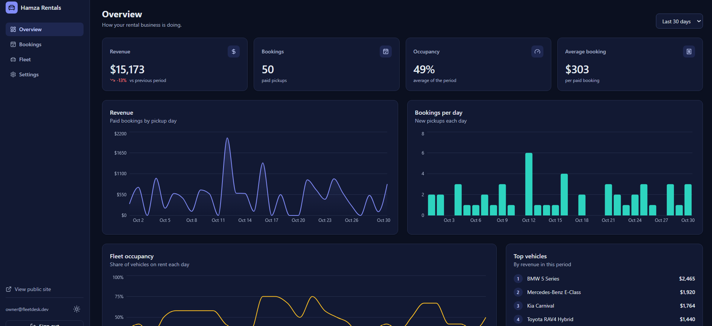
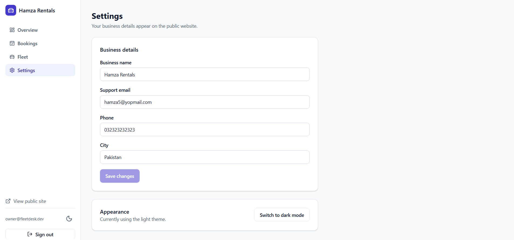

# FleetDesk

A booking and operations app for a small car rental business. Customers pick a car, see which days are free, and book and pay online. The owner manages bookings, the fleet and revenue from a dashboard.

**Live demo:** https://fleetdesk-booking-platform.vercel.app

|             |                                                                                       |
| ----------- | ------------------------------------------------------------------------------------- |
| Owner login | `owner@fleetdesk.dev` / `demo1234` (the login page has a "Fill in demo login" button) |
| Test card   | `4242 4242 4242 4242`, any future date, any CVC (`4000 0000 0000 0002` is declined)   |

## Screenshots

### Home


### Fleet and filters


### Car page with availability calendar


### Booking flow


### Owner dashboard



### Bookings table


### Fleet table


### Setting



This is a portfolio project. Payments run in test mode and no real money moves. The demo data is made up, and the owner can reset it from Settings.

## What it does

**Customer side**

- Browse the fleet, filter by type, price and dates. Only cars free on those dates are shown.
- Each car has a calendar of booked days and a live price for the dates you pick.
- A three-step booking flow (dates, details, review and pay) with validation. The booking draft survives going back and forth.
- Two people can never hold the same car on overlapping dates. The database itself refuses the second booking.

**Owner side**

- Overview: revenue, paid pickups, occupancy and top vehicles, with charts for 7, 30 or 90 days.
- Bookings: search, filter by status, sort, page through results, and move a booking through picked up, returned or cancelled. The row updates immediately and rolls back if the server says no.
- Fleet: add, edit and delete cars, upload a photo, or mark a car as in maintenance to hide it from the site.
- Settings: business details, dark mode, and a button that restores the demo data.

## Tech stack

| Area         | Choice                                                                   |
| ------------ | ------------------------------------------------------------------------ |
| Framework    | Next.js 16 (App Router), React 19, TypeScript in strict mode             |
| Styling      | Tailwind CSS 4 with colour tokens in `globals.css` (light and dark)      |
| Client state | Redux Toolkit for the booking draft                                      |
| Server state | TanStack Query for bookings, cars and analytics, with optimistic updates |
| Forms        | React Hook Form with Zod schemas shared by the form and the API          |
| API          | REST route handlers, plus one GraphQL endpoint for the dashboard numbers |
| Database     | PostgreSQL on Supabase                                                   |
| Charts       | Recharts                                                                 |
| Tests        | Vitest and React Testing Library, Playwright, axe accessibility scan     |
| Delivery     | GitHub Actions CI, Vercel, Supabase (both on free plans)                 |

## Decisions worth knowing

| Decision | Why |
| -------- | --- |

## Project layout

```
src/
  app/            Pages and API routes
    (public)/     Customer site: home, vehicles, booking, checkout, confirmation
    dashboard/    Owner area: overview, bookings, fleet, settings
    api/          REST endpoints and the GraphQL endpoint
  components/     ui (buttons, fields, tables, modal), booking, vehicles, dashboard, layout
  lib/            Shared code: dates, pricing, booking status rules, Zod schemas
  server/
    services/     Business rules
    db/           Repository interface, in-memory and PostgreSQL versions, seed data
    auth.ts       Owner login with a signed cookie
  store/          Redux store and the booking draft
e2e/              Playwright tests
supabase/         schema.sql: tables, constraints and row level security
docs/             screenshot
```
